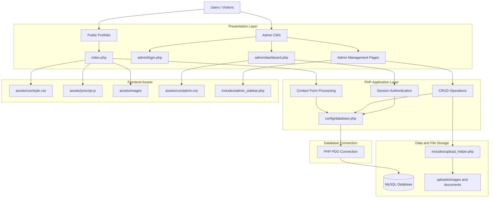

# portfolio-website
Dynamic personal portfolio website with a PHP, MySQL and PDO-based admin CMS.

## 🏗️ System Architecture

The portfolio website uses PHP and MySQL with a dynamic Content Management System (CMS). The architecture separates the public-facing portfolio, admin panel, database operations, and file management.

### Main Technologies

- **Frontend:** HTML, CSS, JavaScript
- **Backend:** PHP
- **Database:** MySQL
- **Database Connectivity:** PDO
- **Authentication:** PHP Sessions and Password Hashing
- **Security:** CSRF Protection and Prepared Statements
- **Hosting:** InfinityFree

### Main Features

- Dynamic personal portfolio
- Secure administrator login
- Content Management System (CMS)
- Portfolio content management
- Project, skills, education and experience management
- Contact form with database storage
- Image and document uploads
- Responsive user interface
